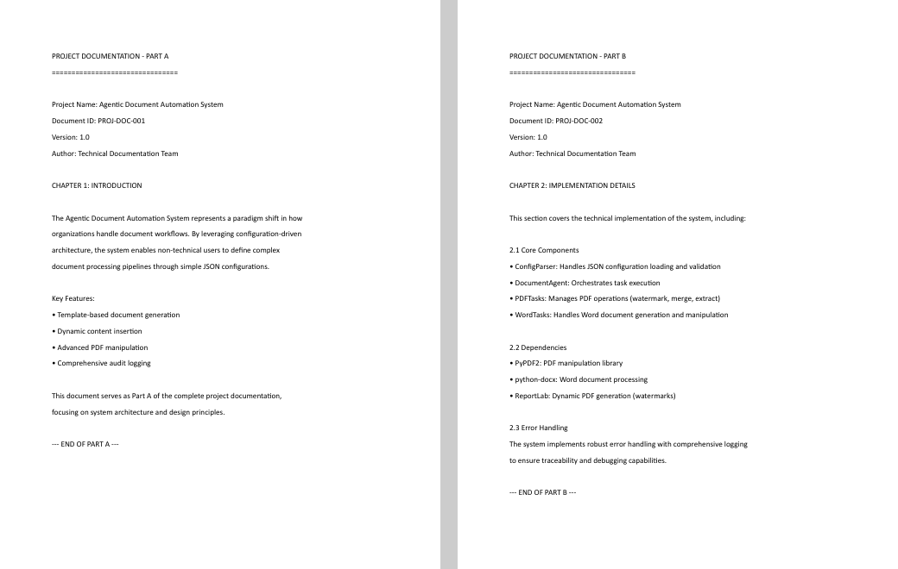
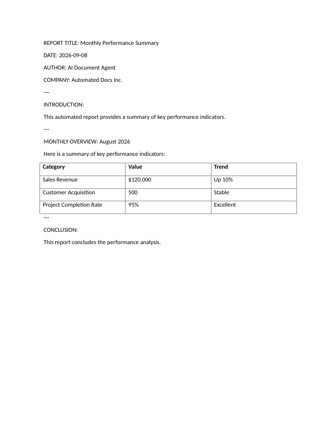
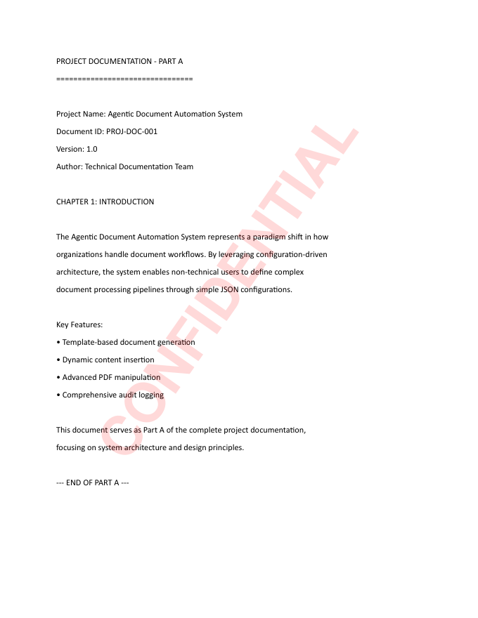

# Week 11 LabX ADV: Agentic Document Automator (PDF & Word)

Video : https://drive.google.com/file/d/1NnSoPx1C3hzNyUBZ_pJvpC1OqFJ2I6rQ/view?usp=sharing

A **config-driven Document Agent**. It reads a list of tasks from
`configs/document_automation_config.json` and runs them in order: it generates a Word report from a
template, watermarks a PDF, merges PDFs, extracts text from Word/PDF, and writes a JSON audit report.

## Screenshots (required for submission)

| File | Screenshot |
| :-- | :-- |
| `documents/merged_docs.pdf`: Part A and Part B combined into one 2-page PDF |  |
| `documents/generated_report.docx`: template placeholders filled, KPI table inserted at `{{TABLE_PLACEHOLDER}}` |  |
| `documents/watermarked_document.pdf`: diagonal red "CONFIDENTIAL" watermark |  |

## How to run

```bash
pip install -r requirements.txt
python main.py
```
(On Windows, if `python` is not recognised use `py main.py` or the full path to `python.exe`.)

Expected end of the console output:
```text
... AUDIT LOG - INFO: Summary: 5 task(s) succeeded, 0 failed. | Task: agent_run_summary
... __main__ - INFO - Document automation process completed.
```

## Tasks in the config

| # | `type` | Input → Output |
| :-: | :-- | :-- |
| 1 | `generate_word_report` | `templates/report_template.docx` + data → `documents/generated_report.docx` |
| 2 | `apply_pdf_watermark` | `documents/source_document.pdf` → `documents/watermarked_document.pdf` |
| 3 | `merge_pdfs` | `dummy_doc1.pdf` + `dummy_doc2.pdf` → `documents/merged_docs.pdf` |
| 4 | `extract_word_text` | `generated_report.docx` → `documents/extracted_word_text.txt` |
| 5 | `extract_pdf_text` | `source_document.pdf` → `documents/extracted_pdf_text.txt` |
| — | audit report (automatic) | `documents/reports/audit_report_<timestamp>.json` |

**Template placeholders:** the template uses `{{REPORT_TITLE}}`, `{{REPORT_DATE}}`, … Values come from
`global_data` (shared by all tasks) and the task's `data`; keys can be written with or without the braces.
`{{TABLE_PLACEHOLDER}}` is replaced by a table built from `table_data` (first row = header, in bold).

**Watermark options:** `watermark_text`, `font_size`, `color` as `[r, g, b, alpha]` (0–1), `angle` in degrees.

## Fixes made to the original code

* Placeholders were replaced without their braces, so the report showed `{{Monthly Performance Summary}}`. Keys are now normalised to `{{KEY}}`.
* The KPI table was appended after "CONCLUSION". It is now inserted exactly where `{{TABLE_PLACEHOLDER}}` is, with borders (the template has no "Table Grid" style).
* The report's `output_path` is now resolved relative to the project folder, so the report lands in `documents/` whatever folder you run from.
* `requirements.txt` was empty; it now lists `PyPDF2`, `reportlab` and `python-docx`.
* Log lines are no longer printed twice, and the run ends with a success/failure summary.

## Project structure

```text
├── src/
│   ├── document_agent.py   # task dispatcher + audit log
│   ├── pdf_tasks.py        # watermark, merge, extract text (PyPDF2 + reportlab)
│   ├── word_tasks.py       # template report, extract text (python-docx)
│   ├── config_parser.py    # load/validate config
│   └── utils.py            # logging, audit entries
├── configs/document_automation_config.json
├── templates/report_template.docx
├── documents/              # inputs (source/dummy PDFs) and generated outputs
├── screenshots/            # screenshots of the three output files
├── main.py
├── requirements.txt
└── README.md
```
