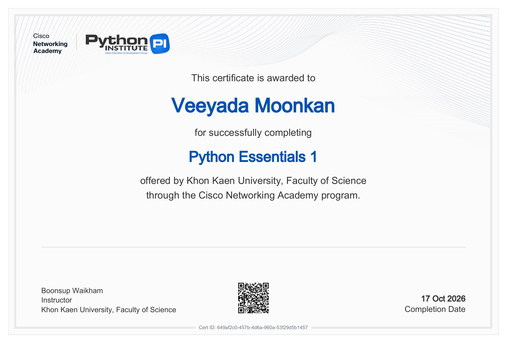

# 663380573-6_sec2_script_programming

**ชื่อ:** วิยดา มูลกัน  
**รหัสนักศึกษา:** 663380573-6  
**รายวิชา:** CP352301 Script Programming Section 2 ภาคเรียน 1/2569

รวบรวมงานทั้งหมดของรายวิชาไว้ใน repository นี้ แบ่งโฟลเดอร์ตามโครงสร้างที่กำหนด

## โครงสร้างโฟลเดอร์

```text
.
├── Lab/                      Lab ประจำสัปดาห์ และ Class Activity
│   ├── Week 1 … Week 6
│   ├── Class Activity 1 … Class Activity 4
│   └── week12
├── Lab X Basic/              LabX Basic
│   ├── Lab 8 Basic
│   ├── Lab 10 Basic
│   ├── Lab 11 Basic
│   └── Lab 12 Basic
├── Lab X Advance/            LabX Advance
│   ├── Lab 8 Advance
│   ├── Lab 10 Advance
│   ├── Lab 11 Advance
│   └── Lab 12 Advance
├── mini Project/             miniproject.md (ลิงก์ไปยัง Mini Project)
├── Final Project/            finalproject.md (ลิงก์ไปยัง Final Project)
└── certificate/              Certificate จาก netacad.com
```

## Lab

| โฟลเดอร์ | เนื้อหา |
|---|---|
| [Week 1](Lab/Week%201) | Lab 1 |
| [Week 2](Lab/Week%202) | Lab 2-1, Lab 2-2 |
| [Week 3](Lab/Week%203) | Lab 3-1, Lab 3-2, Activity 3 |
| [Week 4](Lab/Week%204) | Lab 4-1, Lab 4-2, Activity 4 |
| [Week 5](Lab/Week%205) | Lab 5-1, Lab 5-2, Activity 5 |
| [Week 6](Lab/Week%206) | Lab 6-1, Activity 6-2, my_utils |
| [Class Activity 1](Lab/Class%20Activity%201%20-%20Building%20a%20Simple%20CLI%20Application) | Building a Simple CLI Application |
| [Class Activity 2](Lab/Class%20Activity%202%20-%20OOP%20Fundamentals%20%26%20Refactoring%20the%20CLI%20Task%20Manager) | OOP Fundamentals & Refactoring the CLI Task Manager |
| [Class Activity 3](Lab/Class%20Activity%203%20-%20Interacting%20with%20Web%20APIs%20%28JSON%29) | Interacting with Web APIs: Fetching and Processing JSON Data |
| [Class Activity 4](Lab/Class%20Activity%204%20-%20Project%20Planning%20%26%20Design%20%28Enhanced%20Task%20Manager%29) | Project Planning & Design: Enhanced Task Manager |
| [week12](Lab/week12) | Final Enhanced Task Manager CLI (Week 12) |

## Lab X Basic

| โฟลเดอร์ | หัวข้อ |
|---|---|
| [Lab 8 Basic](Lab%20X%20Basic/Lab%208%20Basic) | Automating with CSV and JSON Data |
| [Lab 10 Basic](Lab%20X%20Basic/Lab%2010%20Basic) | Automating Spreadsheets |
| [Lab 11 Basic](Lab%20X%20Basic/Lab%2011%20Basic) | Automating PDFs & Word Documents |
| [Lab 12 Basic](Lab%20X%20Basic/Lab%2012%20Basic) | Automating Communications (Email & SMS) |

## Lab X Advance

| โฟลเดอร์ | หัวข้อ |
|---|---|
| [Lab 8 Advance](Lab%20X%20Advance/Lab%208%20Advance) | Agentic Data Processing (CSV & JSON) |
| [Lab 10 Advance](Lab%20X%20Advance/Lab%2010%20Advance) | Advanced Spreadsheet Automation & Agentic Workflows |
| [Lab 11 Advance](Lab%20X%20Advance/Lab%2011%20Advance) | Agentic Document Automator (PDF & Word) |
| [Lab 12 Advance](Lab%20X%20Advance/Lab%2012%20Advance) | Agentic Communication Workflows (Email & SMS) |

## Projects

| โฟลเดอร์ | ไฟล์ | Repository ของโปรเจกต์ |
|---|---|---|
| mini Project | [miniproject.md](mini%20Project/miniproject.md) | https://github.com/Sukijtra/663380577-8_Sec2_script_programming/tree/main/Mini%20Project |
| Final Project | [finalproject.md](Final%20Project/finalproject.md) | https://github.com/rapee29/final-project |

ทั้งสองโปรเจกต์เป็นงานกลุ่ม (Group15 Express Coffee) ที่เก็บโค้ดไว้ใน repository ของเพื่อนในกลุ่ม จึงทำเป็นไฟล์ .md ที่สรุปโปรเจกต์และมีลิงก์ไปยังโค้ดจริง

## Certificate

| ไฟล์ | รายละเอียด |
|---|---|
| [Python_Essentials_1_certificate.png](certificate/Python_Essentials_1_certificate.png) | Python Essentials 1 — Cisco Networking Academy (17 Oct 2026) |
| [Python_Essentials_1_certificate.pdf](certificate/Python_Essentials_1_certificate.pdf) | ไฟล์ PDF ต้นฉบับจาก netacad.com |


